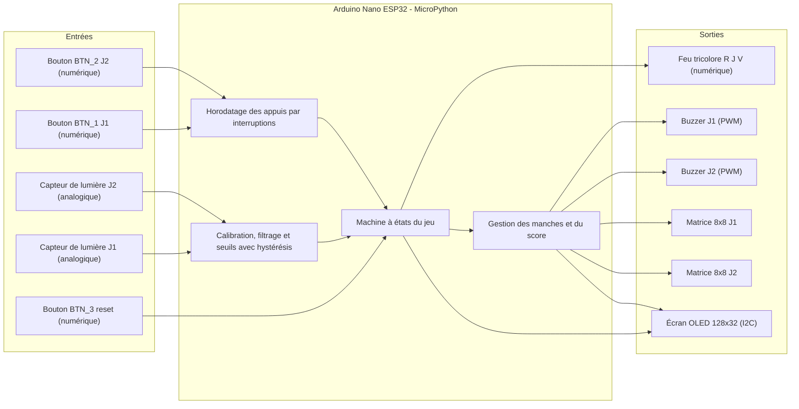
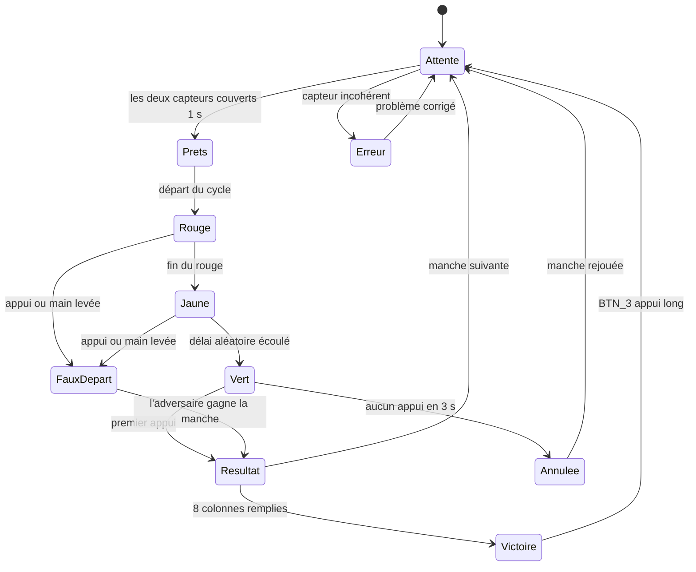

# Livrable 1 — Choix de projet et plan de projet

**Cours 420-314 — Épreuve finale, automne 2026 — Système embarqué interactif**
**Projet : Reflex Duel (duel de réflexes à deux joueurs)**

## 1. Équipe

| Membre | Nom | GitHub |
|---|---|---|
| 1 | Sarragossa | KaissSarragossa |
| 2 | Marius Bazile-Tremblay | Marius Bazile-Tremblay |

Dépôt GitHub de l'équipe : https://github.com/KaissSarragossa/PPE_projet_final.git

## 2. Problème choisi et fonction du prototype

**Problème.** Comment départager deux personnes de façon équitable et visible lors d'un test de rapidité, sans dépendre de l'œil d'un arbitre ?

**Fonction.** Reflex Duel est un jeu de réflexes à deux joueurs basé sur un Arduino Nano ESP32. Il donne un signal de départ lumineux (feu tricolore), mesure qui réagit le premier, et affiche la progression de chaque joueur.

**Déroulement d'une partie.**

1. **Attente.** L'écran affiche « Couvrez votre capteur ». Chaque joueur couvre son capteur de lumière avec la main pour indiquer qu'il est prêt.
2. **Départ.** Quand les deux capteurs restent couverts pendant 1 seconde, le feu passe au rouge.
3. **Suspense.** Le feu passe ensuite au jaune pendant un délai aléatoire, puis au vert.
4. **Manche.** Au vert, le premier joueur qui appuie sur son bouton gagne la manche : sa matrice 8x8 gagne une colonne, son buzzer joue sa tonalité, et l'écran affiche son temps de réaction.
5. **Victoire.** Le premier joueur qui remplit les 8 colonnes de sa matrice gagne la partie (animation et mélodie). Un appui long sur BTN_3 relance une partie.

**Règles particulières.**

- **Faux départ** : appuyer sur son bouton ou lever la main du capteur pendant le rouge ou le jaune fait perdre la manche (l'adversaire gagne une colonne). Si les deux trichent en même temps, la manche est rejouée.
- **Manche annulée** : si personne n'appuie dans les 3 secondes après le vert, la manche est annulée.

## 3. Diagramme fonctionnel

**Trajet des données.** Les capteurs de lumière sont lus par l'ADC, filtrés puis comparés à des seuils calibrés pour décider si un joueur est prêt. Les boutons déclenchent des interruptions qui enregistrent l'instant exact de l'appui. La machine à états décide ensuite des sorties : feu, sons, matrices et écran.

## 4. États du système

## 5. Liste préliminaire des composants

| Composant | Qté | Rôle dans le projet | Type |
|---|---|---|---|
| Arduino Nano ESP32 (ABX00083) | 1 | Cerveau du système, MicroPython | Plateforme |
| Capteur de lumière (sortie analogique AO) | 2 | Présence du joueur : capteur couvert = prêt, main maintenue jusqu'au vert | Entrée **analogique** |
| Bouton poussoir | 3 | BTN_1 et BTN_2 : réponse des joueurs. BTN_3 : réinitialisation | Entrée **numérique** |
| Feu tricolore (3 DEL rouge, jaune, verte) | 1 | Signal de départ | Sortie **numérique** (marche/arrêt) |
| Buzzer **passif** | 2 | Une tonalité par joueur, sons de victoire | Sortie **PWM** |
| Matrice LED 8x8 (2 fils, modèle à confirmer) | 2 | Progression de chaque joueur, une colonne par manche gagnée | **Composant nouveau** |
| Écran OLED 128x32 (I2C) | 1 | Scores, messages, erreurs | Composant d'affichage |
| Résistances de limitation pour les DEL | 3 | Protection des DEL du feu | Passif |

## 6. Attribution préliminaire des broches

| Élément | Broche | Remarque |
|---|---|---|
| BTN_1 | D3 | Entrée avec résistance de rappel interne, bouton vers GND |
| BTN_2 | D4 | Idem |
| BTN_3 | D2 | Idem |
| Feu rouge | D5 | Sortie numérique |
| Feu jaune | D6 | Sortie numérique |
| Feu vert | D7 | Sortie numérique |
| Buzzer 1 | D10 | Sortie PWM |
| Buzzer 2 | D11 | Sortie PWM |
| Capteur de lumière 1 | A0 | Entrée analogique (ADC) |
| Capteur de lumière 2 | A1 | Entrée analogique (ADC) |
| Matrice 1 (signaux 1 et 2) | D8 et D9 | Protocole 2 fils, à confirmer selon le modèle |
| Matrice 2 (signaux 1 et 2) | A2 et A3 | Utilisées comme broches numériques |
| Écran OLED (SDA, SCL) | A4 et A5 | Bus I2C |

Les numéros de broches sont ceux du format Nano. Ils seront confirmés avec la fiche de brochage officielle de l'ABX00083 au Livrable 2.

## 7. Traitement des données et gestion d'erreurs prévus

**Traitement des données.**

- **Calibration** : au démarrage, mesure de la lumière ambiante (moyenne d'environ 20 lectures) pour chaque capteur, utilisée comme référence.
- **Filtrage** : moyenne mobile sur les lectures analogiques.
- **Seuils avec hystérésis** : « couvert » sous environ 30 % de la référence, « découvert » au-dessus d'environ 50 %, avec un délai de 1 s pour éviter les fausses détections (valeurs préliminaires).
- **Horodatage** : les appuis sont enregistrés par interruption avec `ticks_us()` pour départager les joueurs de façon équitable.
- **Code non bloquant** : temporisations avec `ticks_ms()` et `ticks_diff()`, boucle principale courte.

**Gestion d'erreurs.**

- Pièce trop sombre à la calibration : message « Trop sombre » sur l'écran.
- Capteur de lumière débranché ou valeur incohérente : message d'erreur, jeu en pause jusqu'à correction.
- Faux départ, deux appuis simultanés, bouton maintenu enfoncé au début de la manche.
- Aucun appui après le vert : manche annulée.
- Écran absent (détection I2C au démarrage) : le jeu continue avec les matrices, le feu et les buzzers, et un message est envoyé sur le port série.

## 8. Vérification préliminaire du cahier des charges

| Exigence | Prévu |
|---|---|
| Deux capteurs (analogique + numérique) | Capteurs de lumière (analogique) + boutons (numérique) |
| Deux sorties (PWM + marche/arrêt) | Buzzers passifs (PWM) + feu tricolore (numérique) |
| Composant nouveau et substantiel | Matrices LED 8x8 à protocole 2 fils |
| Deux états ou modes | Attente, rouge, jaune, vert, résultat, victoire, erreur |
| Traitement ou calibration | Calibration, filtrage, hystérésis |
| Gestion d'erreurs | Voir section 7 |
| Interaction locale | Capteurs de lumière pour démarrer |
| Au moins deux formes de rétroaction | Lumière (feu, matrices), son (buzzers), affichage (écran) |
| Fonctionnement autonome | Aucune intervention dans le code après le démarrage |

## 9. Répartition initiale du travail

| Membre | Responsabilités principales |
|---|---|
| Membre 1 (Sarragossa) | Capteurs de lumière (calibration, filtrage, hystérésis), boutons et interruptions, machine à états principale, gestion d'erreurs |
| Membre 2 (Marius Bazile-Tremblay) | Pilote des matrices 8x8 et animations de colonnes, écran OLED, feu tricolore, buzzers (PWM), câblage |
| Ensemble | Câblage final, tests, README, vidéo de secours, journal de contribution |

Chaque membre fait ses propres commits sur GitHub selon sa contribution.

## 10. Plan pour les prochains livrables

- **Livrable 2** : lecture séparée des deux capteurs de lumière et des boutons, commande séparée du feu et des buzzers, identification du composant nouveau et lecture de sa documentation.
- **Livrable 3** : scénario principal complet, machine à états, gestion non bloquante, premier test complet.
- **Livrable 4** : calibration finale, gestion d'erreurs, nettoyage du montage et du code, README, vidéo et journal de contribution.

## 11. Utilisation de l'IA

Un outil d'IA (Claude) a été utilisé pour proposer des idées de projet, structurer ce plan et relire l'attribution des broches. Chaque membre doit comprendre l'ensemble des choix. Cette section sera complétée dans le README final.
